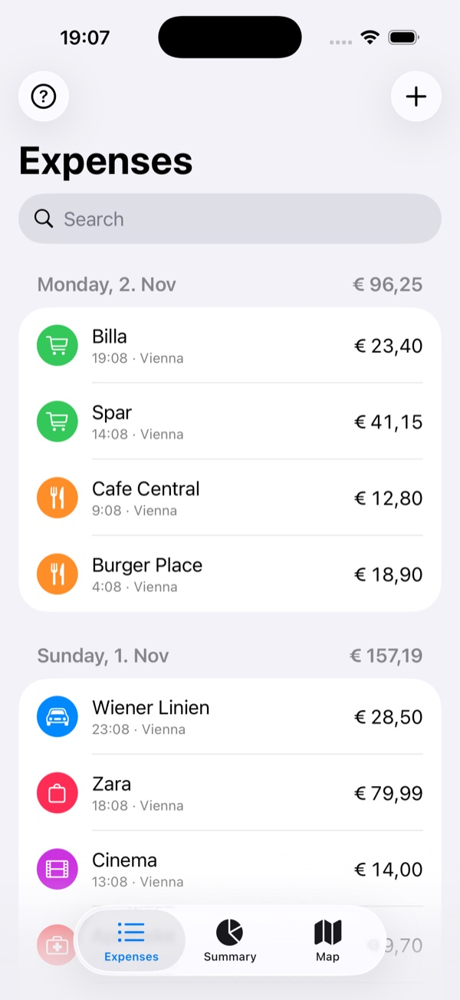
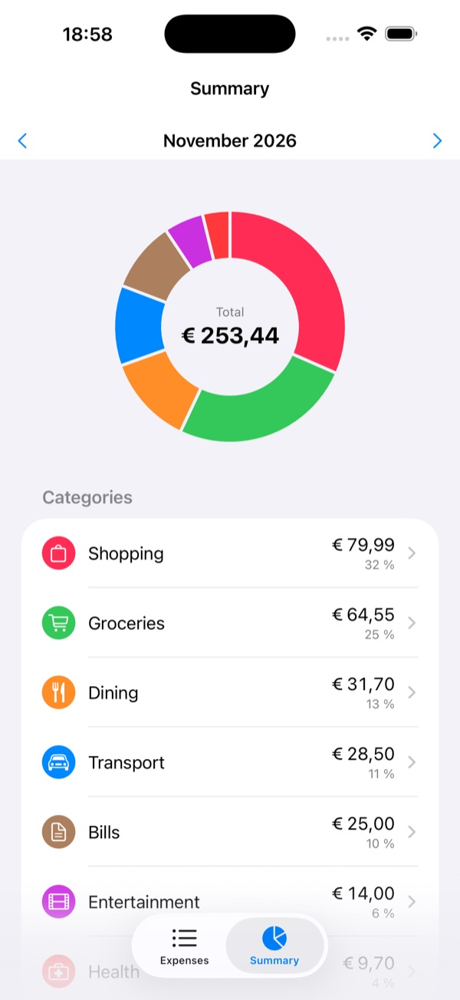
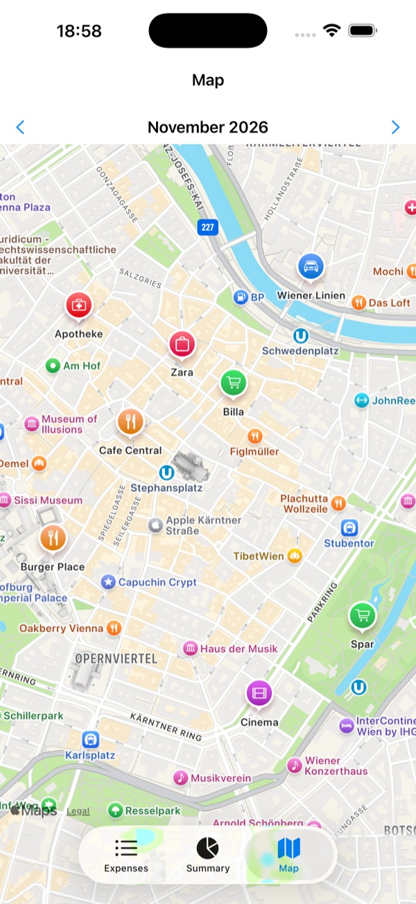

# WalletLog

**Know where your money went — without exporting a single bank statement.**

WalletLog is an iPhone app that automatically records every Apple Pay tap-to-pay: **what** you bought, **where**, **when** and for **how much**. Payments are categorized automatically, summarized per month and shown on a map. Everything stays on your device.

<p align="center">
  
  &nbsp;
  
  &nbsp;
  
</p>

## Features

- **Automatic logging.** Each Apple Pay payment is saved in the background, so you don't have to open the app.
- **Location.** Each payment gets the GPS coordinates and address of where you paid.
- **Smart categories.** Merchants are categorized from a keyword list (Lidl → Groceries, Uber → Transport…). When you change a category, the app remembers it for that merchant.
- **Monthly summary.** A donut chart and a ranked list of categories, which you can open to see each category's payments.
- **Map.** Each month's payments shown as pins, colored by category.
- **Manual entries.** Add cash payments or anything else by hand, and edit or delete any entry.
- **Private.** Data is stored on-device with SwiftData. No account, no server, no tracking.
- **No dependencies.** Built only with Apple frameworks: SwiftUI, SwiftData, App Intents, CoreLocation, MapKit and Swift Charts.

## How it works

iOS doesn't let apps read your Wallet history. Shortcuts can react to payments, though:

```
Tap to pay ──▶ Shortcuts "Transaction" automation ──▶ WalletLog "Log Payment" intent
               (merchant, amount, card)                 + time + GPS location + category
                                                        ──▶ saved on device
```

The Shortcuts **Transaction** automation (iOS 17+) fires on every tap-to-pay and passes the merchant, amount and card to WalletLog's **Log Payment** App Intent. The intent reads the amount (`€12,50`, `1.234,56 €` and `$3.00` all work), gets your current location, chooses a category and saves the payment.

## Setup on your iPhone

1. Install the app (see [Build and run](#build-and-run)).
2. Open **Shortcuts → Automation → + → Transaction**.
3. Select all your cards and choose **Run Immediately**.
4. Add the action **WalletLog → Log Payment**.
5. Set its fields: **Merchant** → *Shortcut Input › Merchant*, **Amount** → *Shortcut Input › Amount*, **Card** → *Shortcut Input › Card*.
6. In Settings, set WalletLog's location permission to **Always**, so payments logged in the background get a location.

The same guide is in the app: tap **?** on the Expenses tab.

## Build and run

Requirements: Xcode 16+, iOS 17+, and [XcodeGen](https://github.com/yonaskolb/XcodeGen) (`brew install xcodegen`).

```sh
xcodegen generate          # creates WalletLog.xcodeproj (not committed)
open WalletLog.xcodeproj
```

Run the tests from the command line:

```sh
xcodebuild -scheme WalletLog \
  -destination 'platform=iOS Simulator,name=iPhone 17 Pro' test
```

**Install on your iPhone:**
1. In Xcode, select your team under *Signing & Capabilities*. A free Personal Team works.
2. Run the app on your device.
3. On the iPhone, trust the developer in *Settings › General › VPN & Device Management*.

With a free Apple ID the app has to be reinstalled every 7 days.

**Sample data:** debug builds accept the launch argument `-seedSampleData`, which fills an empty store with example payments around Vienna.

## Limitations

- Only **tap-to-pay** in stores triggers the automation. Online purchases, in-app Apple Pay and refunds don't.
- The location is where your **phone** is when the automation runs, which is accurate enough for physical stores.
- Totals assume one currency (EUR by default). Each payment still stores its own currency.
- No sync between devices.

## Project structure

```
WalletLog/
├── Models/      Expense, Category, MerchantRule (SwiftData)
├── Services/    AmountParser, LocationService, Categorizer, MonthlySummary, Store, SampleData
├── Intents/     LogPaymentIntent + App Shortcut
└── Views/       Expense list & editor, Summary, Map, Setup guide
WalletLogTests/  Unit tests (parser, categorizer, monthly summary)
project.yml      XcodeGen spec
```

## License

[MIT](LICENSE)
